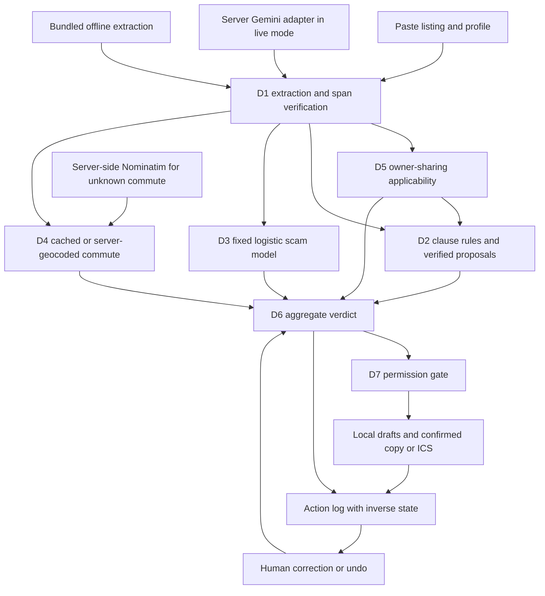

# Architecture

`core/` is shared TypeScript: source-derived JSON data, extraction verification, scoring, decisions, escalation and recovery. Live extraction is the only provider step; deterministic code determines verdicts and permissions. Live failures preserve an explicit reason and use offline rules ([engine](../core/engine.ts), [adapter](../api/gemini.ts)).

Vercel serves the Vite output `web/dist` and Node function handlers in `api/`; `api/analyze.ts` has a 30-second function limit ([vercel.json](../vercel.json)). The local server exposes the same handlers on port 8787; Vite on 5173 proxies `/api` there. Secrets stay on the API side.

The browser offline mode runs the bundled core without a provider request. The React app maintains interactive results and localStorage preferences/listing state; no durable server session database or messaging/payment integration is implemented. Drafts are artifacts for user review, not external transactions. [Recovery details](ACCOUNTABILITY.md).

## Policy and provider boundaries

[D5:52](../core/engine.ts#L52) defaults to applies absent owner residence/sharing evidence; may_not_apply creates a blocking question. [Escalation creation:112](../core/engine.ts#L112) distinguishes blocking questions from notes. D4 unknown is a note, missing address blocks, D2 info topics are notes and suspected violations block. [D6:78](../core/engine.ts#L78) refuses detected pre-viewing payment or sensitive identity/banking requests and high scam risk; otherwise only blocking questions, non-ok clauses or infeasible commute force HOLD. [D7:12](../core/log.ts#L12) still requires zero unresolved escalations, including notes, for ICS.

The configured provider chain is `gemini-3.1-flash-lite` → `gemini-3-flash-preview` → offline extraction. [Adapter defaults:18](../api/gemini.ts#L18) are Flash then Lite without overrides. HTTP 429/503 or primary attempt timeout can trigger the fallback model. Other adapter/schema errors fall to offline rules at the core boundary. [Budgets:4](../api/gemini.ts#L4) are 14 seconds primary and up to 6 fallback, with a 20-second total LLM deadline.

[API:14](../api/analyze.ts#L14) enables [server-side geocoding:5](../api/_lib/geocode.ts#L5) for live requests. If the cached commute is unknown and an address exists, normalized address text is sent to OpenStreetMap Nominatim with regional context, no user identity or full listing, and a generic app User-Agent. An in-process promise cache and queue space starts at least one second apart per process; a five-second fetch timeout follows the queue wait. This can add time beyond the LLM budget. Coordinates still pass the bundled route lookup; failure remains a non-blocking commute note and keeps ICS blocked. Explicit browser offline mode performs neither provider nor geocoder requests. See [privacy and state](ACCOUNTABILITY.md).
