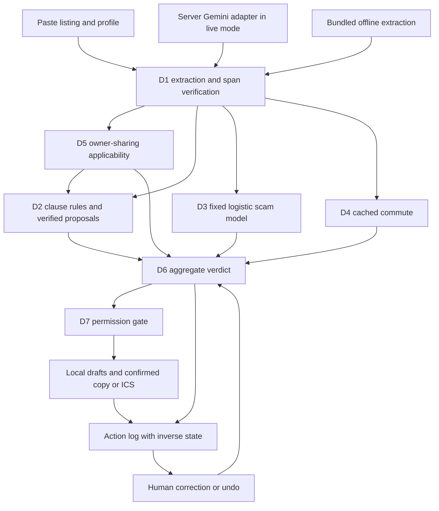

# Architecture

`core/` is shared TypeScript: source-derived JSON data, extraction verification, scoring, decisions, escalation and recovery. Live extraction is the only provider step; deterministic code determines verdicts and permissions. Live failures preserve an explicit reason and use offline rules ([engine](../core/engine.ts), [adapter](../api/gemini.ts)).

Vercel serves the Vite output `web/dist` and Node function handlers in `api/`; `api/analyze.ts` has a 30-second function limit ([vercel.json](../vercel.json)). The local server exposes the same handlers on port 8787; Vite on 5173 proxies `/api` there. Secrets stay on the API side.

The browser offline mode runs the bundled core without a provider request. The React app maintains interactive results and localStorage preferences/listing state; no durable server session database or messaging/payment integration is implemented. Drafts are artifacts for user review, not external transactions. [Recovery details](ACCOUNTABILITY.md).
